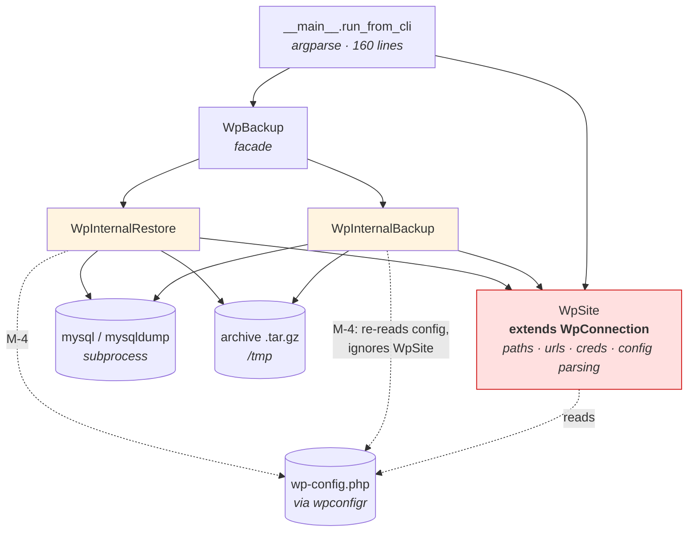

# Architectural Review — py-wordpress-backup

- **Date:** 2026-09-12
- **Reviewer:** l3io-arch-review (Mode B)
- **Scope:** whole repository @ `01ee58c` (v0.2.21)
- **Standards applied:** `standards-core.md` §1–10 + `standards-python.md`
- **Not applied:** `standards-github-actions.md` — no workflows exist (that absence is finding M-18)

---

## Executive summary

The package is small (~1,265 LOC) and its intent is clear, but it is not currently
deliverable: two of its three runtime dependencies (`chesney`, `wpconfigr`) return **HTTP 404
from PyPI**, so `pip install wpbackup2` cannot resolve, and there is no lockfile or
`pyproject.toml` to pin what once worked. Separately, the restore path discards its
`restore_mode` argument, which makes `shutil.rmtree()` of the WordPress directory
unconditional while silently skipping the database restore whenever a database already
exists — a restore run against a live site deletes the files and does not bring the data
back. Database passwords are written to the debug log and passed on the command line.

**4 BLOCKER · 19 MAJOR · 10 MINOR.**

**Single most important action:** fix the restore-mode plumbing (B-3) before anything else —
it is the one defect that destroys user data, and the package's entire purpose is not
destroying user data.

---

## Findings

### BLOCKER

| # | Principle | Location | Finding | Remediation |
|---|-----------|----------|---------|-------------|
| B-1 | Core §7, §8 | `setup.py:41-42` | `chesney` and `wpconfigr` are **gone from PyPI** (`/simple/` returns 404; `pip download` → "No matching distribution found"). The published 0.2.21 is uninstallable. Both were third-party single-maintainer packages with no fork, mirror or vendored copy. | Decide per dependency: vendor `wpconfigr`'s config read/write (it is the load-bearing one), or fork and republish under this project's namespace. `chesney` is used for exactly one call (`chesney.is_appointed()`, `__main__.py:164`) — replace it or drop the `--only-appointed-in-asg` feature. Record the call in an ADR. |
| B-2 | Python overlay — Packaging | repo root | No `pyproject.toml`, no uv/Poetry, no lockfile. `setup.py` is the only manifest and `README.md` instructs `pip install -e .[dev]`. There is no reproducible, locked install path — the overlay names this a BLOCKER explicitly. | Migrate to `uv` + PEP 621 `pyproject.toml`, commit `uv.lock`, set `requires-python`, move `dev` extras to a dependency group, add a `.python-version`. Retire `setup.py`/`setup.cfg` (move bumpversion config into `pyproject.toml`). |
| B-3 | Core §3, §4 | `wp_internal_restore.py:221,224` | `restore()` receives `restore_mode` and then calls `self.__restore_files(archive_filename)` and `self.__restore_database()` **without passing it**. Both fall back to their `ALLCLEAN` defaults. Consequences: (a) `REMOVEFILESBEFORERESTORE` is always in effect, so `shutil.rmtree(site_path, ignore_errors=True)` at `:117` runs even when the caller asked for `ALLOVERWRITE`; (b) `DELETEDATABASEBEFORERESTORE` is always in effect, so the early return at `:161-164` fires whenever the database exists and the restore is **silently skipped with a success log**. `WpRestoreMode.ALLOVERWRITE` is unreachable. Net effect on a live site: files deleted, database not restored, exit 0. | Pass `restore_mode` down to both calls. Add a test per mode asserting `rmtree` is and is not called. Separately re-examine `:161-164` — the guard named "delete database before restore" currently *skips* the restore; the intent was almost certainly the inverse. |
| B-4 | Core §9 | `wp_internal_restore.py:93-101`, `:187`, `:195`; `wp_internal_backup.py:122`, `:125` | Database credentials are exposed three ways: `DB_PASSWORD` is passed to `log.debug()` as a formatted field; the password is embedded in `argv` for `mysql`/`mysqldump`, making it readable in `ps`/`/proc` by any local user; and the full argument list — password included — is logged at DEBUG. | Drop the password from every log statement (log a redaction marker if presence matters). Pass credentials to the client via `MYSQL_PWD` in the subprocess env or a generated `--defaults-extra-file` with 0600 permissions, never argv. |

### MAJOR

| # | Principle | Location | Finding | Remediation |
|---|-----------|----------|---------|-------------|
| M-1 | Core §3 | `__main__.py:150-153` | `--mode` accepts `files\|db\|all`, but the code compares the uppercased value against `"DATABASE"`. `"db".upper()` is `"DB"`, so `--mode db` never matches and silently falls through to `WpBackupMode.ALL`. | Map CLI tokens to the enum once, in a dict or via `WpBackupMode[...]`, so the CLI vocabulary and the domain enum cannot drift. Test each accepted token. |
| M-2 | Core §3 | `__main__.py:179-184` | Eight ternaries of the form `args.new_db_host if "new_db_host" in args else None`. `argparse.Namespace.__contains__` tests attribute presence, which is always true for a declared dest — so every ternary is a no-op. Worse, `"new_site_host"` (`:179`) is **not** a declared dest (the flag is `--new-site-home-url`, dest `new_site_home_url`), so `site_home` is unconditionally `None` and `--new-site-home-url` has no effect. | Delete the ternaries — argparse already defaults these to `None`. Wire `site_home=args.new_site_home_url`. |
| M-3 | Core §3 | `wp_internal_backup.py:150-159` | With `backup_mode == DATABASE`, `__backup_database()` writes the dump to the temp dir and `__backup_files()` is never called — no archive is produced. The run reports success and leaves a loose `.sql` in `/tmp`. | Always produce the archive; let `backup_mode` decide its *contents*, not whether an archive exists. |
| M-4 | Core §1 | `wp_internal_backup.py:58,113-123`; `wp_internal_restore.py:157,184,188` | Both internal classes are handed a fully-populated `WpSite` and then re-open `WpConfigFile` and read connection details from **that** instead. Two sources of truth for the same values; any override carried on `WpSite` (the entire `--new-db-*` surface) is ignored by the code that actually connects. | Read connection details from `WpSite` only. Confine `WpConfigFile` to the two places that legitimately need it: `WpSite.from_wp_path()` and `__update_config()` (the writer). |
| M-5 | Core §1 | `wpsite.py:14-57` | `WpSite` subclasses `WpConnection` (a persistence concern) while also owning the filesystem path, the public site URLs (presentation), admin credentials (authz) and PHP-config parsing (`from_wp_path`). Four concerns in one type, and it is the package's primary public contract. | Split: a `WpConnection`/`DbTarget` value object, a `SiteLayout` (paths), and a `WpConfigReader` factory that assembles them. `WpSite` becomes a composition, not an inheritance of the database type. |
| M-6 | Core §2 | `wp_internal_backup.py:27-28` vs `wp_internal_restore.py:28-29` | `DB_DUMP_ARCNAME` and `WP_DIR_ARCNAME` are duplicated literals defining the **archive format** — the one thing backup and restore must agree on. A change to one silently breaks the other. | Move both to a single `archive_format` module imported by both sides. |
| M-7 | Core §2 | `wp_internal_backup.py:127-143` vs `wp_internal_restore.py:193-208` | Near-identical block: `subprocess.run(capture_output=True)` → check `returncode` → `log.fatal` → raise → `except FileNotFoundError` → `WpDatabaseMysqlFailed`. ~15 meaningful lines, twice. | Extract one `_run_mysql_tool(args, on_failure)` helper; it is also the natural home for the B-4 credential handling. |
| M-8 | Core §2, §4 | `tests/classes/test_wpbackup.py:27-56`, `test_wp_internal_restore.py:31-56`, `test_wp_internal_backup.py` | `_load_settings`, `_setup_test_data` and `_cleanup_test_data` are copied verbatim across three test modules. `_load_settings` is dead in all three — never called. | Replace with shared `pytest` fixtures in `conftest.py`; delete the unused loader. |
| M-9 | Core §4 | `tests/classes/test_wp_internal_restore.py:73` | `instance.__update_config()` is written inside a class body, so Python mangles it to `instance._WpInternalBackupTestCase__update_config` — an attribute that does not exist. The test cannot pass; it only appears green because the module fails to import in an unprovisioned environment (verified: all 4 tests currently error on import). | Test `__update_config` through the public `restore()` path, or promote it to a named internal method. Then make CI fail on import errors so this cannot hide again. |
| M-10 | Core §4 | `test_wpbackup.py:55-73`, `test_wp_internal_restore.py:83-92`, `test_wpsite.py:38-39` | Several tests assert nothing: `test_wpbackup_backup`/`test_wpbackup_restore` call the API and end; `test_wpsite_from_wp_config` has an empty body; `test_wpbackup_restore` (restore module) is entirely commented out. They report PASS while checking nothing. | Add assertions or delete them. An empty test is worse than a missing one — it manufactures a false green. |
| M-11 | Core §4 | `test_wpbackup.py:19`, `test_wp_internal_restore.py:23` | `_temp_dir = tempfile.TemporaryDirectory(...)` is a **class attribute**, evaluated once at import and shared by every test in the class; cleanup is hung on `__del__`, whose timing is not guaranteed. Hidden global state, order-dependent tests. | Use a per-test `tmp_path` fixture. |
| M-12 | Core §4; global rule 3 | `.github/` | No CI whatsoever — `.github/` contains agent definitions only, no workflows. Nothing mechanically enforces lint, tests, build or dependency resolution. Every rule in this repo lives only in prose, which is exactly how B-1 went unnoticed. | Add a workflow: `uv sync --frozen`, `ruff check`, `mypy`, `pytest`, `uv build`. Least-privilege `permissions:`, actions pinned to latest major. Enable Dependabot for `pip` and `github-actions`. |
| M-13 | Core §3; Python overlay | all modules | Zero type annotations in the package; no mypy/pyright configured. Public constructors accept `None` for `db_host`, `db_name`, credentials and branch on emptiness at use sites instead of at the boundary. | Annotate the public surface first (`WpSite`, `WpBackup`), add `mypy` in `strict` where feasible, and validate at construction so the interior can trust its inputs. |
| M-14 | Core §3 (security) | `wp_internal_restore.py:136,143` | `extractall()`/`extract()` are called without `filter=`. Member paths are rewritten at `:130-131` but never checked for containment, so `../` entries or absolute paths in a crafted archive write outside `site_path` (CVE-2007-4559 class). On Python 3.14+ the default changes under you. | Pass `filter="data"` and reject members that escape the destination after rewriting. |
| M-15 | Core §4 (side effects at the edges) | `wpbackup.py:19,26` | Temp directory is hardcoded to `/tmp` with fixed filenames (`database.sql`). Predictable path in a world-writable directory, concurrent runs of the tool clobber each other, and the dump — containing the full database — is left behind after both backup and restore. | Use `tempfile.mkdtemp()` per run, clean up in a `finally`, and keep the caller-supplied `temp_path` as an override only. |
| M-16 | Core §3 | `__main__.py:163-166`, `:135-192` | `run_from_cli()` does `return -1` when the ASG appointment check fails, but the return value is discarded at `:194` — the process exits **0** on that failure. Likewise, invoking with no subcommand leaves `args.action is None`, falls through every branch, and exits 0 having done nothing. | `sys.exit(1)` on the failure path; `arg_parser.error(...)` (or `required=True` on the subparsers) when no action is given. |
| M-17 | Core §3 | `__main__.py:74-76`, `:56-59` | `--cleanfirst` is declared and never read anywhere; `--mode` is declared on the shared parser but ignored entirely on the restore path (restore mode is derived from `--force` instead). Documented CLI surface that does nothing. | Wire `--cleanfirst` and `--mode` into `WpRestoreMode`, or remove them. Add a test asserting each declared flag reaches a behaviour. |
| M-18 | Core §9 | package-wide | No structured logging and no correlation ID. Output is `logging.basicConfig` + interpolated prose strings; a backup and its subsequent restore share no identifier, and the `mysqldump`/`mysql` subprocess boundary carries nothing. A failed run cannot be traced end-to-end by a single ID — the overlay names this a MAJOR finding. | Adopt `structlog` (or stdlib `logging` + JSON formatter) with a `contextvars`-propagated `run_id` bound at CLI entry and included on every record, subprocess invocations included. Record the schema in an ADR. |
| M-19 | Core §7, §8 | `setup.py:40-44` | Beyond B-1: `chesney>=1.0,<=2.0` admits a 2.0 major bump; `wpdatabase2>=0.0.13` is unbounded on a pre-1.0 package, where any release may break; `wpdatabase2`'s last PyPI release is **2020-12-04** (≈5¾ years stale) with a single maintainer who is also this project's author — bus factor 1 across the whole stack. No licence or maintenance record for any dependency. | Bound to compatible ranges, pin exactly in the lockfile, and record a dependency inventory (maintenance, licence, bus factor) with an ADR for each pre-1.0 runtime dependency retained. |
| M-20 | Core §10 | repo root | No `docs/` directory, no ADRs, no diagrams, no operational runbook. `README.md` is the entire documentation surface across all four axes. The backup/restore flow is non-trivial (two subprocess boundaries, an archive format contract, in-place config rewriting, destructive modes) and has no diagram. | Create `docs/` with an index; add a C4 context diagram and a restore sequence diagram (Mermaid); add a runbook covering what a failed restore leaves behind and how to recover; open `docs/adr/` and backfill the decisions listed below. |
| M-21 | Core §10 | `README.md:52-67`, `:70-76`, `:21-24`, `:80` | The README documents flags that **do not exist**: `--admin-user` (actual: `--admin-username`), `--new-site-host`, `--new-db-port`. The "Development" snippet is not valid code (`wp = WpBackup()` then `wpbackup('path', 'archive')`). "TODO: Unit tests" stands although `tests/` exists. "requires Python 3.6 or newer" names an EOL interpreter. Docs that contradict the code stop the next reader from looking. | Regenerate the usage section from `--help` and check it in CI; correct the snippet; drop the stale TODO; state the real supported range from `requires-python`. |
| M-22 | Python overlay — Packaging | `build.sh:33` | `sudo python3 setup.py install` — a build script that installs into the system interpreter as root, using a deprecated command. Also `build.sh:10-11` runs `git commit` with no message argument (opens an editor) inside a script. | Replace with `uv build`; drop the sudo install entirely. Let the release workflow, not a local script, publish. |

### MINOR (auto-defers to backlog)

| # | Principle | Location | Finding | Remediation |
|---|-----------|----------|---------|-------------|
| m-1 | Core §5, §6 | nearly every module, line ~3-10 | `# pylint: disable=line-too-long` at module scope, plus per-line repeats in `exceptions/__init__.py`. The rule is silenced globally rather than the lines wrapped. | Adopt `ruff format`; delete the blanket disables. |
| m-2 | Core §6 | package-wide | `####...####` banner comment blocks before every method and a `# Main Application` box in `__main__.py:19-23`. Visual noise carrying no information the signature lacks. | Remove. |
| m-3 | Core §3 | `wpsite.py:47-57` | `try: log.debug(...) except Exception: pass` — a bare swallow around a log statement. | Delete the try/except; if a field may be absent, guard the field. |
| m-4 | Core §5 | `wpsite.py:90-99` | The `site_host` property returns `self._site_host`, which nothing ever assigns; meanwhile `__init__:34` sets `site_home` as a plain attribute with no property pair. Reading `site_host` raises `AttributeError`. | Delete the dead property or rename it to back `site_home`. |
| m-5 | Core §1 | `wpsite.py:12,79` | Raises the dependency's `InvalidArgumentsError` from this package's public factory, while `wpbackup2.exceptions` exists. Callers must import from `wpdatabase2` to handle it. | Raise a `wpbackup2` exception. |
| m-6 | Core §6 | `exceptions/database_backup_failed.py:13` | The **backup** failure message reads "Database restore failed for file ..." — copy-pasted from the restore exception. | Correct the message; assert on it in a test. |
| m-7 | Core §5 | `wpbackup.py:18-19`, `wp_internal_backup.py:41-46`, `wp_internal_restore.py:45-49` | Class-level attribute declarations (`__what_if = False`, `__temp_path = None`, `__log = None`) that `__init__` immediately shadows with instance attributes. Reads as shared state, is not. | Delete; keep the assignments in `__init__`. |
| m-8 | Python overlay — Test | `test.py` | A hand-rolled runner script wrapping `coverage run -m unittest discover`; the overlay prefers `pytest` invoked directly. `check_call(['coverage','report'])` is commented out at `:21`, so coverage is collected and never reported. | Delete `test.py`; run `pytest --cov` from CI and locally. |
| m-9 | Core §5 | `setup.py:14-15`, `test_wpbackup.py:5,52`, `test_wp_internal_restore.py:16,56,88-90`, `__init__.py:5` | Commented-out code retained in seven places. Git holds the history. | Delete. |
| m-10 | Packaging | `setup.py` | No `console_scripts` entry point, so the documented invocation is `python3 -m wpbackup2`. No `python_requires`. | Add `[project.scripts] wpbackup2 = "wpbackup2.__main__:run_from_cli"` and `requires-python` in `pyproject.toml`. |

---

## Current structure (as reviewed)

The red node is finding M-5: the type that four concerns meet in. The dotted edges are M-4:
the two internal classes bypass the domain object they were handed and re-read the PHP config,
which is why the entire `--new-db-*` CLI surface has no effect.

---

## Per-principle walkthrough

| Principle | Result |
|-----------|--------|
| §1 Separation of concerns | **FAIL** — M-4, M-5, m-5 |
| §2 Reuse over copy-paste | **FAIL** — M-6, M-7, M-8 |
| §3 Design by contract | **FAIL** — B-3, M-1, M-2, M-3, M-13, M-14, M-16, M-17, m-3 |
| §4 Testability | **FAIL** — B-3, M-8, M-9, M-10, M-11, M-12, M-15 |
| §5 Brevity without sacrificing readability | **FAIL** — m-1, m-2, m-4, m-7, m-9 |
| §6 Comments explain current state | **FAIL** — m-2, m-6, m-9 (no changelog-in-comments found; docstrings present throughout — the one consistent strength) |
| §7 Dependency selection | **FAIL** — B-1, M-19 |
| §8 GA over alpha/beta | **FAIL** — M-19 (unbounded pre-1.0 runtime dependency in the shipped path, no ADR; `Development Status :: 4 - Beta` is declared but never justified) |
| §9 Unified correlated logging | **FAIL** — B-4, M-18 |
| §10 Documentation | **FAIL** — M-20, M-21 |
| Python overlay — packaging & lockfile | **FAIL** — B-2, M-22 |
| Python overlay — version & runtime | **FAIL** — no `requires-python`; README claims 3.6 (M-21) |
| Python overlay — type checking | **FAIL** — M-13 |
| Python overlay — lint/format | **PARTIAL** — `.pylintrc` present and configured; overlay prefers `ruff`, and the blanket disables (m-1) undercut what is configured |
| Python overlay — test | **FAIL** — M-9, M-10, M-11, m-8 (`unittest`, not `pytest`) |
| Python overlay — logging | **FAIL** — B-4, M-18 |
| GitHub Actions overlay | **N/A** — no workflows exist; see M-12 |

No principle passed cleanly. `.editorconfig`, consistent docstrings, and the deliberate
`what_if` dry-run affordance are the genuine strengths and are worth preserving through any
restructuring — though note that `what_if` does not protect the destructive path (B-3 runs
`rmtree` only when `not self.__what_if`, so dry-run is safe, but `--force` is not what a user
would expect it to mean).

---

## Gate

**NOT PASSED.** 4 BLOCKER + 19 MAJOR must be resolved or ADR-justified before sign-off.
10 MINOR defer to the backlog.

Suggested order:

1. **B-3** — data loss, and the cheapest fix here (two arguments).
2. **B-4 / M-14** — credential exposure and archive extraction.
3. **B-1 / B-2 / M-19** — restore a resolvable, locked dependency set. Until this lands, no
   one can run the test suite, so nothing else is verifiable.
4. **M-12** — CI, so items 1–3 stay fixed.
5. **M-1, M-2, M-3, M-16, M-17** — the CLI contract defects, as one pass.
6. **M-4, M-5, M-6, M-7** — the structural cleanup, once tests can run.
7. **M-20, M-21** — documentation, last, so it describes what is actually there.

---

## Recommended ADRs

Author via `assets/adr-template.md` into `docs/adr/`:

| Slug | Decision to record | Principles in tension |
|------|--------------------|----------------------|
| `dependency-recovery-chesney-wpconfigr` | Vendor, fork, or replace the two dependencies that vanished from PyPI | §7, §8 |
| `packaging-uv-pyproject` | Adopt uv + PEP 621; retire `setup.py`/`setup.cfg`/`build.sh` | Python overlay |
| `restore-mode-semantics` | Define what each `WpRestoreMode` flag guarantees, and which combinations are destructive | §3 |
| `credential-handling-subprocess` | How credentials reach `mysql`/`mysqldump` and what may be logged | §9 |
| `logging-schema-and-run-id` | Logging library, schema, and the correlation ID propagated across the subprocess boundary | §9 |
| `wpsite-decomposition` | Split the `WpSite` god object; whether to keep the `WpConnection` inheritance | §1 |
| `archive-format-contract` | The `.tar.gz` layout as a versioned contract between backup and restore | §1, §2 |
| `test-strategy` | pytest, fixture strategy, and what requires a real MySQL vs. a fake | §4 |
| `python-support-range` | Supported interpreter range and EOL policy | §8, Python overlay |

---

*Generated by `l3io-arch-review` Mode B. Findings B-1, B-3, M-2, M-9 were verified by
execution or network probe; all others by direct source inspection at the cited lines.*
