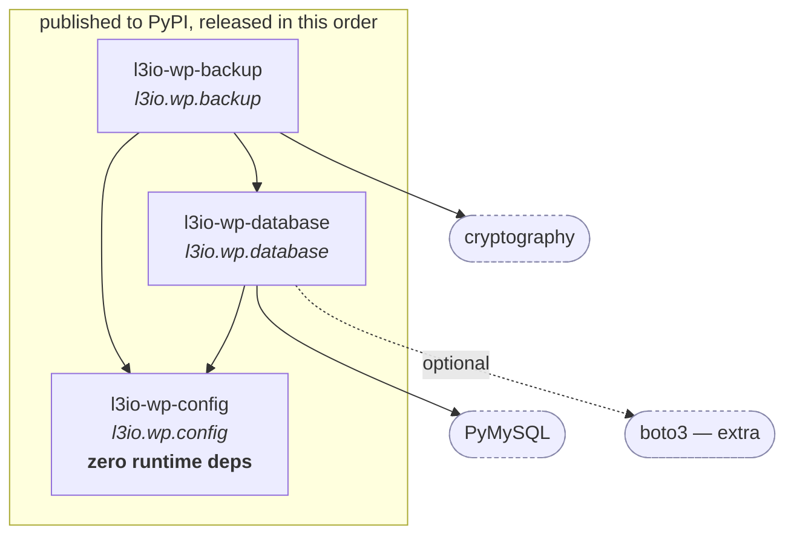
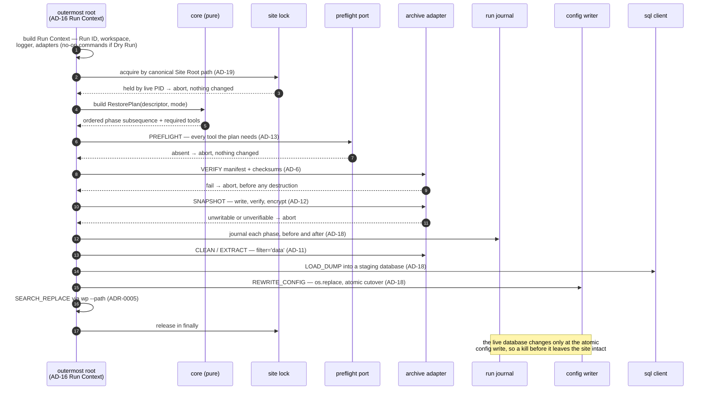

# Architecture Spine — wpbackup2 family

## Design Paradigm

**Ports and adapters (hexagonal), with a functional core and an imperative shell.**

The core computes *plans* and never performs effects. Every effect — subprocess, filesystem, network, clock, randomness — is reached only through a port, and a port is satisfied by an adapter chosen at the edge.

This is chosen over the current class-per-operation layout for one concrete reason: it makes Dry Run (FR-19) and data-integrity refusal (NFR-1) structural rather than conditional. Today `--what-if` is an `if not self.__what_if:` repeated at eight effect sites; `restore_mode` was dropped at two call sites and produced an unconditional `rmtree`. Both are the same defect class — a value that every call site must remember to honor. A plan that a no-op adapter can execute has no site left to forget.

The pre-rewrite `wpconfigr` already separates a pure core (`WpConfigString`, operating on a string) from an I/O shell (`WpConfigFile`), so the *separation* is ratified rather than invented. Its **mechanism** is not: the shell subclasses the core, where this paradigm requires composition through a Protocol. See AD-1.

| Layer | Contains | May import |
| --- | --- | --- |
| `domain/` | Value objects, Restore Mode, Backup Scope, `RestorePhase`, archive-format constants, plan types | stdlib only |
| `core/` | Plan construction, validation, decisions, **pure text transforms** (`WpConfigString` belongs here) | `domain/` |
| `ports/` | Protocol definitions — the interfaces effects are reached through | `domain/` |
| `adapters/` | Real implementations: subprocess, filesystem, tar, storage, secrets. **`WpConfigFile` lives here** | `domain/`, `ports/`, `core/` |
| `cli/`, `api/` | Composition roots — bind adapters, build the Run Context, translate errors | all of the above |

`adapters/` may import `core/`: `wpconfigr`'s `WpConfigFile` *subclasses* the pure `WpConfigString`, and an I/O shell wrapping a pure core is the paradigm working, not a violation. The forbidden direction is inward-facing — `domain/` and `core/` may never import `ports/`, `adapters/`, or a composition root.

## Invariants & Rules

### AD-1 — The core computes plans; only adapters perform effects

- **Binds:** all three packages
- **Prevents:** effect logic spreading into decision logic, where it cannot be tested without a live WordPress and MySQL (NFR-8), and where each new effect site becomes another place a mode flag can be forgotten
- **Rule:** modules under `core/` and `domain/` import no I/O module and never import `ports/`, `adapters/`, `cli/` or `api/`. They return plan values; effects happen only in `adapters/`, reached through a `ports/` Protocol.
- **The mechanism is composition, not inheritance.** An adapter *holds* a core object and satisfies a Protocol; it does not subclass the core. Subclassing would make every core method public on the adapter automatically, so the declared public surface leaks by construction and `__all__` cannot bound it. The pre-rewrite `wpconfigr` implemented its pure/impure split by inheritance (`WpConfigFile(WpConfigString)`), which is the right separation reached by the wrong mechanism — it is converted to composition, not preserved.
- **Enforcement, and its honest reach:** an import-linter `forbidden` contract in CI covers the *module* prohibitions — `subprocess`, `socket`, `shutil`, `tarfile`, `boto3` (the last requires `include_external_packages = true`) and the inward-facing layer rule. It **cannot** see builtins, so `open()`, `time.time()` via a re-export, and RNG reads are outside its reach; those are covered by a small AST check in the same CI job. Stating this because a guard that claims more reach than it has stops the next reader looking.

### AD-2 — Package dependencies run one way, and `l3io-wp-config` stays dependency-free

- **Binds:** `l3io-wp-config`, `l3io-wp-database`, `l3io-wp-backup`
- **Prevents:** a cycle across separately released repositories, and the shared kernel acquiring a dependency that every dependent then inherits — the shape that made `boto3` transitively mandatory
- **Rule:** `l3io-wp-config` ← `l3io-wp-database` ← `l3io-wp-backup`, strictly. `l3io-wp-config` declares **zero** runtime dependencies, permanently. No package imports a dependent. A capability needed by two packages moves *down* to `wpconfigr` only if it can arrive dependency-free; otherwise it is duplicated deliberately and the duplication is recorded.



### AD-3 — One immutable Site Descriptor, parsed once at the edge

- **Binds:** `wpdatabase2.WpConnection`, `wpbackup2.WpSite`, every consumer of connection details
- **Prevents:** two writers for one value. Today `db_host`'s setter derives `_db_port` by splitting on `:` while `db_port` has its own independent setter, so the pair can desync; and the internal backup/restore classes re-read `wp-config.php` instead of using the descriptor they were handed, so every `--new-db-*` override is silently ignored
- **Rule:** the Site Descriptor is a frozen value object constructed once, at the boundary, from exactly one source. `host:port` is split during construction and never afterwards. No setters. Any code needing connection details receives the descriptor — no module below the composition root opens `wp-config.php` for values the descriptor already carries. The single exception is the config *writer* (FR-11), which writes and does not read for its own use.

### AD-4 — Dry Run is adapter selection, never a conditional

- **Binds:** FR-19, and every adapter
- **Prevents:** the `--what-if` defect class — an effect site added later that forgets to check the flag, silently making Dry Run destructive
- **Rule:** no `if dry_run:` anywhere in `core/` or `adapters/`. **Every port splits into queries and commands.** A Dry Run binds the *real* query implementations and no-op command implementations, so validation, verification, preflight and refusal logic all execute for real and only writes are suppressed — a Dry Run that reports "would restore" where the real run would refuse is a defect, not a simplification. The core is byte-identical between the two.
- **Enforcement:** a `grep` gate in CI fails on `dry_run` or `what_if` appearing in any module outside a composition root, and a plan-equality test asserts the core emits an identical plan under both adapter sets.

### AD-5 — Restore Mode is a closed set, resolved once, carried as a value

- **Binds:** FR-6, FR-7, FR-8, NFR-1
- **Prevents:** the B-3 data-loss defect exactly — `restore()` received `restore_mode` and called its sub-steps without it, so both silently fell back to `ALLCLEAN` defaults and `shutil.rmtree` became unconditional
- **Rule:** Restore Mode is an explicitly enumerated, closed set, named in the PRD's §4 Glossary and defined once in `domain/`. It is resolved at the composition root and passed explicitly down every call; **no function that consumes a Restore Mode may declare a default for it.** A destructive element is authorized only by the flag that names that specific destruction — no flag authorizes destruction generally.
- **Enforcement:** an AST check in CI fails when any parameter annotated `RestoreMode` (or `BackupScope`) carries a default. This is the invariant that maps directly to the unconditional-`rmtree` data loss; it is checked, not remembered.

### AD-6 — The archive format is one owned contract

- **Binds:** FR-1, FR-3, FR-4, FR-10, and the §8 archive-format contract
- **Prevents:** backup and restore drifting on the one thing they must agree on. Today `DB_DUMP_ARCNAME` and `WP_DIR_ARCNAME` are duplicated literals in two modules
- **Rule:** one module in `domain/` owns member roles, the Manifest schema, the format version and the encryption envelope. Backup and restore both import from it; neither defines a member name. The layout is fixed:

  1. an **unencrypted tar container**;
  2. `manifest.json` as its **first member, never encrypted** — it carries the format version, the KDF salt and parameters, the member index and the checksums, so an Archive can be identified, version-gated and have its salt read *before* any key exists.
  3. per-member payloads, each encrypted independently when encryption is on.

  **Reading v0.** Archives written before this rewrite have no Manifest: a plain `.tar.gz` with members `database.sql` and `wp-root/`. Restore detects that shape and reads it **by default, permanently** — not behind a legacy opt-in. A v0 Archive has no checksums, so Verification degrades to a structural check (expected members present, tar readable) and says so in its report rather than claiming an integrity guarantee it cannot make. Nothing writes v0.

  **Member roles are enumerated** — `dump`, `site-root`, `config` — and every member path is role-prefixed and non-escaping. A `wp-config.php` living outside the Site Root (FR-29) is carried as a `config`-role member with its original location recorded as Manifest *metadata*, never as a `../` path. Checksums are computed over **bytes as stored**. A Manifest is written on every Archive and read before every restore. The supported format range is derived from committed fixture Archives exercised in CI — never a hand-maintained list.

### AD-7 — Credentials reach a subprocess by file, never by argument or environment

- **Binds:** FR-15, NFR-3, every MySQL client invocation and every in-process database driver connection
- **Prevents:** credential disclosure via `ps`/`/proc` and via logs — the current code passes `-p<password>` in `argv` and logs the full argument vector at DEBUG
- **Rule:** one credential-transport adapter writes a `[client]` option file into the per-Run workspace at mode `0600`, passes it as **`--defaults-file`, before any other option**, and deletes it in a `finally`. **`--defaults-file`, never `--defaults-extra-file`** — the latter is *additive*, so an ambient `~/.my.cnf` or `/etc/my.cnf` still applies and a stray `[client] host=` there can silently redirect a restore to a different database server. The rule covers the in-process driver (PyMySQL) too: credentials reach it as call arguments, never in a connection string that gets logged or stored.

  **This mechanism does not reach WP-CLI.** `wp` bootstraps PHP and uses `$wpdb`; it never invokes the MySQL client and accepts no option file. Its credentials come from the `wp-config.php` written in the preceding phase (AD-17, ADR-0005). `MYSQL_PWD` is forbidden: MySQL's own manual calls it extremely insecure and deprecates it as of 8.4. No credential value is passed to a logging call at any level; where a command line is logged, credential-bearing elements are replaced with a redaction marker.
- **Enforcement — mechanical, not by review.** Five assertions, because a rule this
  one carried by inspection is a rule that decays:
  1. no credential in any log record, at any level, asserted against captured
     `structlog` events **and** stdlib records, across a full backup and a full
     restore — the paths that actually emit a command line;
  2. no credential in any constructed argument vector, asserted against the vector
     rather than by reading the call site;
  3. every `repr` clean — Site Descriptor, credentials, connection;
  4. the exception raised to a caller clean, because a traceback is log output
     under another name;
  5. the option file's mode is `0600` and it is removed, asserted on the success
     path **and** the failure path.

  A sibling package guards the same guarantee with a test that no module imports
  `subprocess`. That test is sound there and **vacuous here** — this package shells
  out by design, so the guarantee has to be carried by the assertions above.

### AD-8 — An optional dependency is an optional import

- **Binds:** FR-14, FR-25, `wpdatabase2`
- **Prevents:** an extra becoming mandatory through a module-scope import. This is the live defect: `credentials.py` imports `Secret` at module scope and `secret.py` imports `boto3` at module scope, so importing `WpCredentials` drags `boto3` into every install
- **Rule:** a dependency declared under an optional extra is imported **inside the function or method that uses it**, never at module scope. Absence raises a package-owned error naming the extra to install. CI asserts that a base install — no extras — imports every public module successfully.

### AD-9 — Credential resolution is an explicit call, not a property read

- **Binds:** FR-14, NFR-3, NFR-8
- **Prevents:** two things, on independent grounds. First, hidden network I/O behind an attribute access. `WpCredentials.username` and `.password` are property getters that call `_resolve_secret()`, which performs an AWS round trip and mutates `self` — untestable, unpredictable in failure timing, and invisible at the call site
- **Rule:** a Credential Provider is a port with one explicit `resolve()` returning a frozen credential value. Property getters perform no I/O and no mutation. Resolution order is declared in `domain/` and is deterministic. **A provider never silently substitutes one credential for another** — the current fallback of reusing ordinary database credentials as admin credentials for `CREATE DATABASE`/`GRANT` is removed; absent admin credentials is an error naming what is missing.

### AD-10 — One logger, one Run ID, bound at the composition root

- **Binds:** FR-20, NFR-6, the log *stream* of all three packages
- **Prevents:** a Run that cannot be traced end to end, and per-package logging dialects
- **Rule:** `structlog` over stdlib `logging`, configured once at the composition root and never in a library module — library modules only acquire a bound logger. **`l3io-wp-config` does not import `structlog`**, because AD-2 makes its zero-dependency rule permanent: it emits through stdlib `logging.getLogger(__name__)` and the composition root's `ProcessorFormatter` pulls those records into the same structured stream. The binding is on the stream, not on every package taking the dependency. **The OpenTelemetry logs signal is not used**: at 1.44.0 it is still Development status and its modules are underscore-private (`opentelemetry._logs`), with the changelog warning of breaking changes. Logging is structlog; tracing is AD-24; the two meet only through the correlation fields below. The Run ID is bound with `structlog.contextvars`, with `merge_contextvars` **first** in the processor chain, and appears on every record including those emitted around subprocess boundaries. Third-party records are routed through `ProcessorFormatter` so one stream carries everything. A library caller may bind their own correlation ID and see it on our records.

### AD-11 — An Archive is untrusted input

- **Binds:** FR-3, FR-10, NFR-5
- **Prevents:** path traversal from a crafted Archive writing outside the destination (CVE-2007-4559 class); today `extractall` is called with rewritten member paths and no containment check
- **Rule:** one extraction function in `adapters/`, used by every restore path. It passes **`filter='data'` explicitly** whenever the interpreter supports it, guarded by `hasattr(tarfile, "data_filter")` — the parameter is only patch-level-dependent on 3.11 via backport, so an unconditional `filter=` raises `TypeError` there; where it is absent, extraction refuses rather than falling back to `fully_trusted`. Containment is re-checked after member-path rewriting, against the enumerated roles of AD-6. Verification (FR-3) completes before the first destructive step, not during extraction.
- **Enforcement:** a test extracts a fixture archive containing `../escape` and asserts refusal, on every supported Python version in the CI matrix.

### AD-12 — Every Run owns a private workspace

- **Binds:** NFR-4, FR-8, FR-19
- **Prevents:** collision between concurrent Runs and symlink-clobber in a shared directory. Today the temp path is hardcoded `/tmp` with the fixed filename `database.sql`, and the dump is left behind
- **Rule:** the shell creates one workspace per Run via `tempfile.mkdtemp`, owner-only, and removes it in a `finally` on both success and failure. The core never learns a filesystem path it did not receive. A caller-supplied temp location is an override of *where* the workspace is created, never of the per-Run isolation.
- **The Safety Snapshot is a full Archive and is held to every Archive rule.** It outlives the Run. It is **verified after writing** (AD-6) — the one Archive taken precisely when things are about to go wrong must not be the one Archive nobody checks. It is **encrypted when encryption is configured**, closing the same hole the PRD's Q-8 reversal closed. Its scope is derived from the Restore Mode, so it captures everything that Mode may destroy. It is written **outside the Site Root and outside any web-served directory** — never to a default that could be served — and its path is reported. If it cannot be written and verified, the destructive restore does not proceed.

### AD-13 — External tools are checked at the port, before the first effect

- **Binds:** FR-13, FR-27, NFR-1
- **Prevents:** a partial relocation — config rewritten, content URLs not — because WP-CLI was discovered missing halfway through
- **Rule:** every external binary (`mysqldump`, `mysql`, `wp`) sits behind a port exposing a preflight check reporting presence and version. The composition root runs preflight for every tool the *plan* requires before executing any step of it. A missing tool aborts with nothing changed, names the tool, and states why it was needed.

### AD-14 — Errors cross a public boundary only as package-owned types

- **Binds:** FR-23, all three packages
- **Prevents:** callers importing a dependency to catch our failures, and a dependency swap becoming a breaking change. Today `WpSite.from_wp_config` raises `wpdatabase2`'s `InvalidArgumentsError`, and a missing archive surfaces as a bare `FileNotFoundError`
- **Rule:** each package defines its own exception hierarchy under a single base. An exception from a dependency or from the stdlib is caught at the boundary and re-raised as a package-owned type with `raise ... from`. Exceptions carry structured fields, not only a formatted message. No exception message contains a credential.

### AD-15 — The three packages release in dependency order behind a resolvability gate

- **Binds:** Release A, FR-25, FR-26
- **Prevents:** republishing the outage this product is recovering from — a dependent published against a dependency that does not resolve
- **Rule:** release order is `l3io-wp-config` → `l3io-wp-database` → `l3io-wp-backup`.
- **"Resolves from the index" means the index a real consumer uses.** An internal
  mirror is a mirror, not a home. The `liquidlogiclabs` Gitea registry is
  limited-visibility and returns 401 unauthenticated, so anything published only
  there is unresolvable for a consumer without credentials — which means a package
  on PyPI whose dependency lives only on the mirror has an **unresolvable dependency
  graph**, reproducing exactly the outage this work exists to repair. Every
  dependency of a publicly installable package must itself be publicly resolvable,
  from the same index a stranger would use. The mirror satisfies AD-15's gate only
  for a dependent that also resolves through it and carries the credentials.
- **Decided:** the Gitea index is a **temporary staging ground**; PyPI is the
  destination once all three packages are refactored. The constraint above is
  therefore a sequencing rule rather than a permanent split — nothing goes to PyPI
  until everything beneath it can too.
- **The gate:** each release is gated by a CI job that, in a clean environment on
  every supported Python version, installs the built artifact and imports it. A
  dependent is not released until its dependency resolves from the index its
  consumers will use. Every runtime dependency carries an upper bound excluding an
  unreviewed major. Publication is by GitHub Actions trusted publishing — no
  long-lived token, no local `twine`, no `sudo` — and **PyPI publication is never
  triggered by a tag**, because it burns a filename permanently and must be an
  explicit decision rather than a side effect.

### AD-16 — One Run Context, created by the outermost composition root

- **Binds:** FR-8, FR-19, FR-20, FR-28, all composition roots
- **Prevents:** a nested composition root forking the Run. The Safety Snapshot (FR-8) is naturally implemented by calling the backup entry point — the DRY choice, and compliant with every other AD — which would create a second Run ID, reconfigure `structlog` a second time, race two `finally` blocks over one workspace, and deadlock against the Site Lock the outer Run already holds, making *every* destructive restore refuse
- **Rule:** a Run Context — Run ID, workspace, logger, Site Lock, clock, bound adapter set — is created exactly once, by the outermost composition root, and passed inward. An entry point that receives a Run Context **joins** it and creates nothing. The Site Lock is re-entrant for its holder. Creating a Run Context while one is active is an error, not a second Run.

### AD-17 — Restore phase order is data, not a diagram

- **Binds:** FR-6, FR-11, FR-12, FR-13, NFR-1
- **Prevents:** two plan builders emitting the phases in different orders. Loading the dump before rewriting `wp-config.php` sends it to the *source* Archive's database and reports success. The order previously existed only in a sequence diagram — a diagram is not a rule
- **Rule:** `RestorePhase` is an ordered enum in `domain/`: `PREFLIGHT → VERIFY → SNAPSHOT → CLEAN → EXTRACT → REWRITE_CONFIG → LOAD_DUMP → SEARCH_REPLACE`. A plan is a **subsequence** of it — a Restore Mode may omit phases, never reorder them, so reordering is structurally unrepresentable. A test asserts the phase sequence against recording adapters for every Restore Mode.

  `REWRITE_CONFIG` precedes `SEARCH_REPLACE` because WP-CLI has no credential flags: it bootstraps WordPress from the config we just wrote (ADR-0005). That ordering is forced by the tool, not chosen.

### AD-18 — A killed Run must be recoverable

- **Binds:** NFR-1, FR-8, FR-9, FR-11
- **Prevents:** the failure mode this whole product exists to avoid. Every destructive phase is individually irreversible and none is atomic; `mysql < dump.sql` is not one transaction. A crash midway leaves a site that **boots and looks fine** — `wp_options` from the Archive, `wp_postmeta` from before — and nothing tells the operator. A prose runbook is not a recovery mechanism
- **Rule:** three requirements, none optional:
  1. **Run Journal** — a durable record written to the Safety Snapshot's directory before each phase begins and after it completes, naming the phase, the target, and what would undo it. A Run that finds a journal from an incomplete Run refuses to proceed until the operator resolves it, and reports exactly which phase was interrupted.
  2. **Atomic config write** — `wp-config.php` is written to a temporary file in the same directory, **verified before** the `os.replace`, and only then moved into position, so a failed verification leaves the original byte-identical. A partial config is never observable. This package **delegates the write and its verification to `l3io-wp-config`** rather than reimplementing either; that package owns the read-back rules of ADR-0010, including the fact that verification compares the **value span** and not the whole statement — a whole-statement comparison rejects correct writes to any `wp-config.php` using WordPress's own `define( 'KEY', 'value' );` spacing, which this repository's own test fixture does.
  3. **Staging-database cutover** — the dump loads into a staging database, not the live one; the live name is switched only by the atomic config write above, after the load has completed and been checked. An interrupted load leaves the live site on its original database, untouched.

### AD-19 — The Site Lock

- **Binds:** FR-28, NFR-4
- **Prevents:** two Runs destroying one Site concurrently. FR-28 was bound by no invariant at all, and the obvious implementation is worse than none: a lock file inside the Site Root is deleted by the `files-clean` restore that holds it, releasing the lock mid-destruction
- **Rule:** the Site Lock is identified by the **canonical absolute Site Root path**, and is held **outside the Site Root** — in a per-user state directory — so no restore scope can delete it. It is acquired by the outermost composition root (AD-16) before the first phase and released in a `finally`. It carries the holder's PID and start time; a lock whose PID is gone is reclaimable with a logged warning, a live one is an error naming the holder. It binds the CLI and library callers identically — it is not a `cli/` concern.

### AD-20 — An Archive becomes visible only when it is complete

- **Binds:** NFR-2, FR-1, FR-16, FR-17
- **Prevents:** a partial Archive being mistaken for a usable one — by a later restore, or by a Retention Policy that prunes a good Archive in favour of a truncated newer one
- **Rule:** every `ArchiveStore` adapter writes to a temporary name in the destination and makes the Archive visible at its final name only after the write completes and its Manifest verifies — `os.replace` locally, atomic completion semantics remotely. A failed write leaves nothing at the final name. Retention (FR-17) never prunes the most recent Archive that passes Verification. This binds the local store shipping in v1.0, not only the v1.1 remotes.

### AD-21 — Archives stream; nothing buffers a whole Archive

- **Binds:** NFR-7, FR-1, FR-3, FR-4, FR-16
- **Prevents:** a working implementation that dies on a real site. Archives are routinely multi-gigabyte, and this is exactly why Fernet was rejected (ADR-0006) — but the rejection secured only the encryption layer, leaving tar, dump, store and verify free to buffer
- **Rule:** every port that moves Archive bytes exposes a chunked or file-object interface, never `bytes`. No adapter reads an Archive, a Dump or a member wholly into memory. Peak RSS is bounded by a constant independent of Archive size, asserted in CI against a fixture Archive an order of magnitude larger than that bound.

### AD-22 — The CLI is a frozen contract; the Python API is not

- **Binds:** FR-21, FR-22, FR-24, §8, §10, every composition root
- **Prevents:** a rewrite that silently breaks the invocations in operators' cron files and systemd units — and, in the other direction, a rewrite that drags the old class design forward into the new API because nobody said which surface was actually protected
- **Rule:** the CLI surface as shipped at v0.2.21 is **preserved**: both subcommands, all nineteen flag spellings including the camelCase `--whatIf`, and `python -m wpbackup2` as a working invocation. Flags may gain behaviour and new flags may be added; **no existing flag is renamed or removed.** A console-script entry point is added alongside, never instead. The **Python API is explicitly not preserved** — it is redesigned freely, and the rewrite is a major version that says so.

  **One forced exception.** `--only-appointed-in-asg` cannot work: it required `chesney`, which no longer exists on any index. The flag is still **accepted** and fails with an error naming the removal and the reason — an operator whose cron job carries it must get an explanation, not argparse's `unrecognized argument`.

  **Defects are fixed, intent is preserved.** Where current behaviour contradicts a flag's own documented purpose it is corrected, and each correction is a named entry in the release notes: `--mode db` performs a database backup rather than silently backing up everything; `--cleanfirst` selects the clean Restore Mode flags rather than being ignored; `--force` overrides the non-empty-target refusal (FR-7) rather than being the only way to reach clean mode; failures exit non-zero (FR-21). Preserving those bug-for-bug would make the rewrite pointless.

### AD-23 — Archive format detection is explicit and one-way

- **Binds:** FR-3, FR-10, AD-6, NFR-1
- **Prevents:** two units disagreeing on how an Archive's format is recognised — and a v0 Archive being silently treated as a corrupt v1, which for a backup tool reads as "your backup is gone" when it is not
- **Rule:** detection is split so no tar parsing happens in a pure layer. An **`ArchiveProbe` port** in `adapters/` opens the container with stdlib `tarfile` and returns the raw member index; a **pure classifier in `domain/`** maps that index to a format. A first member named `manifest.json` means v1 and its `format_version` governs; members `database.sql` and `wp-root/` with no Manifest mean v0; anything else is rejected as unrecognised, naming what was found. Detection is never inferred from filename or extension, and **tar, gzip and JSON parsing are never hand-written**. (AD-1 forbids `domain/` both `tarfile` and `open()`; a detector placed there would have had to hand-roll a tar header reader in the least testable layer — exactly the trap the standards forbid.)

  **Everything downstream consumes a normalized `ArchiveView`, never a format version.** The classifier returns one value object carrying synthesized member roles, `checksum: str | None`, and `integrity: VERIFIED | STRUCTURAL_ONLY`. **No module outside `domain/archive_format` branches on version.** A v0 Archive has no Manifest, roles or checksums, so without this normalization AD-6, AD-11, AD-17 and AD-21 each read two ways and two builders resolve them differently; with it, a v0 restore is an ordinary restore whose `integrity` is `STRUCTURAL_ONLY`. AD-17's phase-order test carries a v0 fixture beside the v1 one.

  **Writing is v1 only** — no code path produces a v0 Archive, so there is one write format to test. The Run's logs report which format was read.

### AD-24 — Tracing is API-only and inert unless a host configures it

- **Binds:** FR-20, NFR-6, every phase in AD-17, all three packages
- **Prevents:** two failure shapes at once — instrumentation that forces a tracing stack, a collector and a configuration burden onto an operator running this from cron, and the opposite, a library that goes dark inside a host application which *has* already invested in tracing
- **Rule:** the packages depend on **`opentelemetry-api` only, never the SDK** — the pattern OpenTelemetry's own library guidelines mandate. One transitive dependency, and with no SDK configured it resolves to a `ProxyTracer` returning `NonRecordingSpan`: no output, no error, no cost. The SDK and an exporter live in an optional `otel` extra, and the umbrella `opentelemetry-exporter-otlp` is **forbidden** as a dependency because it pulls `grpcio`.

  Spans follow AD-17's phases, not files: a root span per Run with a child per phase. Attributes use CLI semantic conventions where they map (`process.exit.code`, `process.executable.name`, `error.type`) plus `wpbackup2.phase`, `db.name`, `archive.bytes` and `dry_run`. **`process.command_args` is recorded only after the redaction of AD-7** — a span attribute is as public as a log line.

  Logs and traces correlate through a structlog processor that adds `trace_id` and `span_id` when a span is recording and nothing when it is not. structlog's `add_open_telemetry_spans` is the reference, but it is a **copy-me example in structlog's documentation, not shipped API** — structlog 26.1.0 imports no `opentelemetry` — and it nests values under a `span` dict. We write our own emitting **flat** `trace_id` and `span_id`, because flat keys are what aggregators index without configuration. That processor is the *only* coupling between the two systems.

  **Subprocess trace context is deliberately not propagated.** `TRACEPARENT` injection is skipped because none of `mysqldump`, `mysql` or `wp` reads that environment variable — the OTel env-carrier spec is a Release Candidate and Python's implementation is underscore-private, so injecting it today writes a breadcrumb nothing follows. (MySQL can ingest trace context via the `traceparent` query attribute; that is a different mechanism, and not one a `mysqldump` invocation uses.) Revisit when a tool in the chain consumes the environment variable.

  **What tracing does not replace.** Every phase emits `phase`, `duration_ms`, `exit_code` and `bytes` as structured log fields regardless of whether tracing is configured. An operator with a log file and `jq` gets the full operational picture with no collector. Tracing adds value when this library runs *inside* something already traced; it is never the only way to see what a Run did.

### AD-25 — CLI flags map to Restore Mode through one total function

- **Binds:** FR-6, FR-7, AD-5, AD-22, `cli/`
- **Prevents:** the largest unowned surface the rewrite creates. `--cleanfirst`, `--force` and `--mode` produce twelve reachable states against six Restore Modes, and nothing said what each means. `--cleanfirst` alone against a non-empty target makes one builder `rmtree` and another refuse — both compliant, one destroys a site
- **Rule:** a **total** mapping from flag combination to `(RestoreMode, OverrideSet)` lives in one table in `domain/`. Every reachable combination has an entry; there is no default branch. `OverrideSet` is a **distinct type from `RestoreMode`**, so `--force` is structurally incapable of selecting a Mode — it can only waive the FR-7 refusal. Read plainly: `--cleanfirst` chooses a clean Mode, `--force` waives the non-empty-target refusal, and `--cleanfirst` *without* `--force` against a non-empty target **refuses**, because the destruction is authorized but the target guard is not.
- **Enforcement:** the test's scope is derived from the argparse parser itself — its `choices` and `store_true` actions — so a flag added later without a mapping fails CI rather than falling into an implicit default.

### AD-26 — One passphrase resolution chain, or no encryption at all

- **Binds:** FR-4, FR-8, AD-12, AD-22, NFR-3
- **Prevents:** a plaintext Safety Snapshot arriving by default. AD-12 requires the Snapshot encrypted "when encryption is configured", but the preserved CLI has **no passphrase surface** — only `--admin-password` and `--new-db-password` — so a literally compliant build configures encryption never and writes a plaintext copy of the entire database to disk, which is precisely what shipping FR-4 in v1.0 exists to prevent
- **Rule:** one declared passphrase-resolution chain — explicit argument, then environment variable, then an interactive prompt when a TTY is present — shared verbatim by both composition roots, so CLI and library callers resolve identically. AD-22 permits new flags, and the passphrase surface is one: adding it is required, not optional. **There is no silent plaintext Snapshot path.** If a Run would take a Safety Snapshot and no passphrase resolves, it either proceeds unencrypted *having said so explicitly in its output and logs*, or refuses — and which of those is the default is a product decision recorded before v1.0 ships, not a builder's choice.

### AD-27 — The `l3io.wp` namespace is PEP 420 native, in every distribution

- **Binds:** all three distributions, their build configuration, ADR-0012
- **Prevents:** the classic namespace-package failure, and it is a textbook divergence pair. Three separately-released distributions share the `l3io.wp` root. If one ships an `__init__.py` at `l3io/` or `l3io/wp/` — which every packaging tutorial and most build-backend defaults encourage — it becomes a *regular* package and shadows the namespace, so importing it makes the other two vanish. Each package passes its own tests in isolation; the breakage appears only when two are installed together, with an `ImportError` that names the wrong thing
- **Rule:** **no distribution ships `__init__.py` at `l3io/` or `l3io/wp/`.** Each ships exactly `src/l3io/wp/<area>/__init__.py` and below. The build backend is configured to include the namespace directories without generating markers, and each `pyproject.toml` declares the same layout.
- **Enforcement:** the check is cross-package by necessity — a distribution tested alone cannot catch this — but it does **not** have to wait for all three to exist. A **stub sibling** claiming the same namespace (about ten lines of `pyproject.toml` and one module) proves the invariant today — but **only one install shape can actually contain the failure, and it is not the obvious one.**

  With two wheels in a single `site-packages`, both distributions unpack into the *same* directory, so a planted `l3io/wp/__init__.py` still leaves that regular package's single `__path__` entry containing the sibling's subdirectory: **the sibling imports anyway and the check passes over a defect that is present.** Measured, not reasoned.

  The shadow is observable only when the two distributions occupy **different `sys.path` entries** — one editable plus one wheel, in either direction. That shape is therefore mandatory, and the two-wheel shape is a supplement, never the whole check. A guard built only from the two-wheel case reports success over a set that excludes the defect it exists to catch, which is the same failure this rule is written to prevent.

  `l3io.wp.__path__` must merge the site-packages entry with the editable tree; verified working with the compliant layout in all three shapes. Each repository runs the stub check from its own pipeline; the release pipeline of the last package runs the real three-way version.
- **The type checker will advise the violation.** `mypy --strict` on a namespace package suggests adding `__init__.py`, which is precisely what breaks the siblings. Configure `namespace_packages`, `explicit_package_bases` and `mypy_path` instead, and never take the suggestion.

### AD-28 — A database name in a GRANT is escaped, because it is a pattern

- **Binds:** every package that issues `GRANT`, `l3io-wp-database` and `l3io-wp-backup`'s restore path, FR-9, NFR-3
- **Prevents:** silently granting access to databases the operator never named. MySQL matches the database name in a database-level `GRANT` as a **LIKE pattern**, so `_` is a single-character wildcard: `GRANT ... ON \`wp_site\`.*` also grants on `wpXsite`. Backticks do **not** suppress it — quoting an identifier is not the same as escaping a pattern. Essentially every WordPress database name contains an underscore, so the default case over-grants
- **Rule:** the database name in a `GRANT` is escaped for LIKE semantics — `_` becomes `\_`, `%` becomes `\%` — by one shared function, never inline at a call site. That function is the only place a grant target is rendered. Escaping applies to the grant *pattern* only, never to `CREATE DATABASE` or to connection parameters, where the literal name is required.
- **Enforcement:** a regression test that asserts the neighbouring database is **unreachable**, never that the statement text looks escaped. A test on the rendered SQL passes against an implementation that escapes the wrong clause; only reachability distinguishes the two. Shape: create `wpX<suffix>` alongside `wp_<suffix>`, provision `wp_<suffix>`, connect as the WordPress user, and assert `wp_<suffix>` is visible, `wpX<suffix>` is not, and connecting with `database=wpX<suffix>` raises.
- **Implementation:** `l3io-wp-database` owns it. `quote_grant_database` is exported from the `l3io.wp.database` package root, with `quote_identifier` for the literal-name cases. Dependents **import it** rather than reimplementing — AD-2 makes the direction legal and Core §2 makes duplicating it a defect. Verified there against MySQL 8.0, 8.4 and MariaDB 11.4.

### AD-29 — Existence is answered by the administrator, never inferred from a failed login

- **Binds:** FR-9, AD-9, `l3io-wp-database`'s provisioning, `l3io-wp-backup`'s restore path
- **Prevents:** a state model that cannot be implemented, and two units disagreeing about what exists. **MySQL authenticates before it resolves the database**, so on a fresh site — no account, no database — a connection as the WordPress user fails with `1045 Access denied` and never reaches `1049 Unknown database`. "Database absent" is therefore **not observable** from the account being provisioned until that account already exists. A unit that probes with WordPress credentials and one that probes with administrator credentials will report different states for the same server
- **Rule:** any check of whether a database, user or grant exists is performed with the **administrator** credentials. A failed login by the account being provisioned is evidence about the account, never about the database. No state enumeration may list a pre-provisioning "database absent" state as distinguishable from "account absent" when observed through the WordPress account; where the distinction is genuinely unreachable, the type says so rather than implying a precision the protocol cannot deliver.
- **Consequence for AD-9:** this is a second, independent reason administrator credentials must be supplied explicitly rather than falling back to the WordPress credentials. The first is privilege escalation; this one is that the fallback makes existence unanswerable.
- **Enforcement:** an integration test covering the reachable case — account exists, database does not — and a docstring on any "absent" state recording what cannot be observed and why. Found in `l3io-wp-database` by an integration test that asserted the unreachable state and failed: the code was right and the test was wrong.

## Consistency Conventions

| Concern | Convention |
| --- | --- |
| Naming — packages | Distribution `l3io-wp-<area>` maps to import `l3io.wp.<area>` (ADR-0012, AD-27) |
| Naming — console scripts | Named for the distribution, **unless an outward-compatibility constraint names it otherwise** — `l3io-wp-backup` ships `wpbackup2` per AD-22. Module invocation is kept alongside, never instead (ADR-0007) |
| Naming — modules | `snake_case`; layer is the directory (`domain/`, `core/`, `ports/`, `adapters/`, `cli/`, `api/`), never a filename suffix |
| Naming — ports and adapters | Port is the capability (`ArchiveStore`, `CredentialProvider`, `SqlClient`); adapter is implementation-prefixed (`LocalArchiveStore`, `S3ArchiveStore`, `NoopSqlClient`) |
| Naming — domain terms | The PRD §4 Glossary verbatim. A new domain noun is added to the Glossary in the same change |
| Public surface | Declared by `__all__` in each package `__init__`; everything else is internal regardless of underscore. `py.typed` shipped by all three |
| Data — identifiers | Run ID is a UUIDv4 string, generated at the composition root, never derived from time or path |
| Data — timestamps | UTC, ISO-8601 with explicit offset, in the Manifest and in every log record |
| Data — Manifest | JSON, one schema version field, forward-compatible reads ignore unknown keys |
| Errors | One base per package; structured fields; `raise ... from`; never a dependency type across a boundary (AD-14) |
| Logging | `structlog`, JSON in non-interactive mode, human-readable when a TTY; configured only at a composition root (AD-10) |
| Config | Explicit argument, then environment, then `wp-config.php` — resolution order declared in `domain/`, never discovered ad hoc |
| Typing | Full annotation on every public surface; `mypy --strict` in CI; a `type: ignore` carries a reason |
| Tests | `pytest`; the functional core is tested without a live WordPress or MySQL (NFR-8); adapters have contract tests; a small integration tier is marked and separable |
| Commit of generated docs | CLI usage in the README is generated from `--help` and checked in CI — the current README documents three flags that do not exist |

## Stack

Verified current 2026-09-15. Seed — the code owns this once it exists.

| Name | Version |
| --- | --- |
| Python (floor) | >=3.11 |
| Supported OS | Linux and macOS. AD-7's `0600` option file and AD-12's owner-only workspace are POSIX guarantees; Windows is unsupported in v1.x and refused at preflight rather than silently degraded |
| uv | 0.12.15 |
| ruff (lint + format) | 0.16.7 — pinned exactly, pre-1.0 |
| mypy | 2.3.1 |
| pytest / pytest-cov | 9.1.1 / 7.1.0 |
| structlog | 26.1.0 |
| opentelemetry-api (runtime, always) | 1.44.0 — API only, never the SDK |
| opentelemetry-sdk (extra: `otel`) | 1.44.0 |
| opentelemetry-exporter-otlp-json-file (extra: `otel`) | 0.65b0 — JSONL to disk; the umbrella `opentelemetry-exporter-otlp` is forbidden, it drags `grpcio` |
| cryptography | 50.0.1 |
| PyMySQL | 1.2.0 |
| boto3 (extra: `aws`) | 1.43.95 |
| import-linter (AD-1 enforcement) | current at adoption — verify before binding |
| WP-CLI (external, relocation only) | 2.12.0 |
| mysqldump / mysql (external) | client 8.4+ — 8.0 Extended Support ended 2026-04-30, and ADR-0003 depends on 8.4 behaviour |
| MariaDB server / client (parity target, PRD Q-3) | 11.4 LTS — tested in the CI matrix alongside MySQL |

## Structural Seed

```text
wpbackup2/
  domain/        # value objects, RestoreMode, BackupScope, archive format, Manifest, plans
  core/          # plan construction and validation — pure
  ports/         # Protocols: ArchiveStore, SqlClient, ConfigWriter, SearchReplace, CredentialProvider, Clock
  adapters/      # subprocess, tarfile, local + remote stores, encryption, preflight
  cli/           # argparse composition root
  api/           # importable composition root
```

Restore, the path where the invariants earn their place. The order is **normative and defined by AD-17**; this diagram illustrates it and does not define it.



## Capability → Architecture Map

| Capability | Lives in | Governed by |
| --- | --- | --- |
| FR-1, FR-2, FR-5 backup | `core/backup`, `adapters/tar` | AD-1, AD-6, AD-12 |
| FR-3, FR-10 manifest and verification | `domain/archive`, `adapters/tar` | AD-6, AD-11 |
| FR-4 encryption | `adapters/crypto` | AD-6, AD-26, ADR-0006 |
| FR-6, FR-7, FR-8, FR-9 safe restore | `core/restore` | AD-5, AD-12, AD-25, AD-28, AD-29, NFR-1 |
| FR-11, FR-29 config rewriting | `wpconfigr`, `ports/ConfigWriter` | AD-2, AD-3, ADR-0010 |
| FR-12, FR-13 relocation | `adapters/wpcli` | AD-13, ADR-0005 |
| FR-14, FR-15 credentials | `ports/CredentialProvider`, `adapters/credentials` | AD-7, AD-8, AD-9 |
| FR-16, FR-17 storage and retention | `ports/ArchiveStore` | AD-1, AD-6 |
| FR-19 dry run | every adapter | AD-4 |
| FR-20 correlated logging | composition roots | AD-10, AD-16 |
| FR-21 exit codes | `domain/exit_codes`, `cli/` | AD-14 — the code table is part of the §8 CLI contract |
| FR-28 concurrent runs | `adapters/lock` | AD-19, AD-16 |
| FR-18 scheduling (v1.1) | deferred — see Deferred | AD-19 supplies the mutual exclusion it needs |
| NFR-1 integrity paramount | `core/restore` | AD-5, AD-17, AD-18 |
| NFR-2 atomic publication | `ports/ArchiveStore` | AD-20 |
| NFR-3 secret hygiene | `adapters/credentials` | AD-7, AD-9 |
| NFR-4 idempotent retry | composition roots | AD-12, AD-18, AD-19 |
| NFR-5 untrusted archives | `adapters/tar` | AD-11 |
| NFR-6 observability | composition roots | AD-10, AD-16, AD-24 |
| NFR-7 performance envelope | every byte-moving port | AD-21 |
| NFR-8 testability | `core/`, `domain/` | AD-1, AD-4 |
| FR-22, FR-23, FR-24 Python API | `api/`, per-package `__init__` | AD-14, AD-22 — redesigned freely; not compat-bound |
| §8 CLI contract, outward compatibility | `cli/` | AD-22 |
| FR-10 v0 archive reads | `domain/archive_format` | AD-23, AD-6 |
| FR-25, FR-26, FR-27 supply chain | CI, `pyproject.toml` ×3 | AD-2, AD-15, AD-27 |

## Deferred

- **Remote Storage Target *backends*** (S3, SFTP, rsync) — v1.1. The **addressing grammar is not deferred**: v1.0's local store must already accept a scheme-qualified target string, because §10 makes accepted values a breaking surface and a v1.0 that takes bare paths cannot add schemes without a major bump.
- **Incremental backup** — PRD Q-5, out of scope for v1.x. Would change the archive format; AD-6's version field is the seam.
- **Multisite** — PRD non-goal; would change the Site Descriptor's cardinality.
- **Scheduling internals** — FR-18 is v1.1 and may yet be cut to declarative config only.
- **Concrete module tree below the layer directories** — the code owns it. Only the layer boundaries are fixed (AD-1).
- **Whether `wpdatabase2` keeps a provisioning role at all** — AD-3 and AD-9 remove most of its current reason to exist as a separate package. Revisit after Release A. **Not deferred meanwhile:** database provisioning has exactly one implementation, in `wpdatabase2`, and `wpbackup2` never issues `CREATE DATABASE` or `GRANT` itself. Two provisioning paths would differ on collation and only one would fall inside AD-7's test scope.
- **Thirteen lower-ranked divergence pairs** from the second adversarial pass remain open in `reviews/review-adversarial-divergence-delta.md` (E-6 onward), together with the prior pass's D-6, D-7 and D-8. The six release-blocking ones are closed by AD-23, AD-25, AD-26 and the AD-7 / AD-10 corrections; the remainder are recorded rather than silently dropped, and should be triaged before the first epic that touches the restore path.
- **Data governance mechanics** (PRD §7.2) — retention as the erasure control surface, and the residency rule that no adapter relocates data between regions on its own initiative, are binding on every `ArchiveStore` adapter and land with FR-16/FR-17 in v1.1. Recorded here so they are not rediscovered then.
